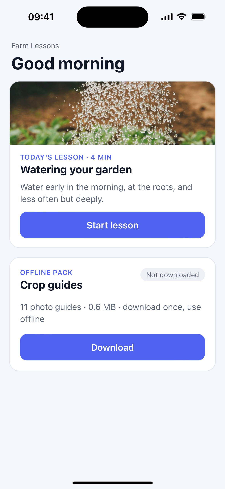
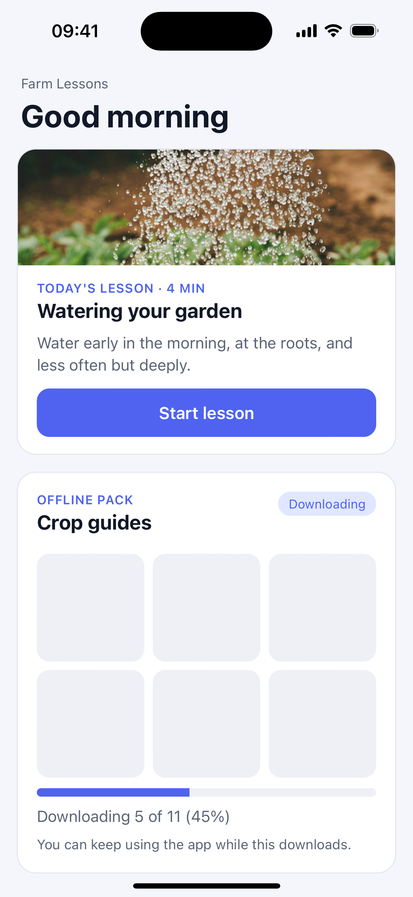
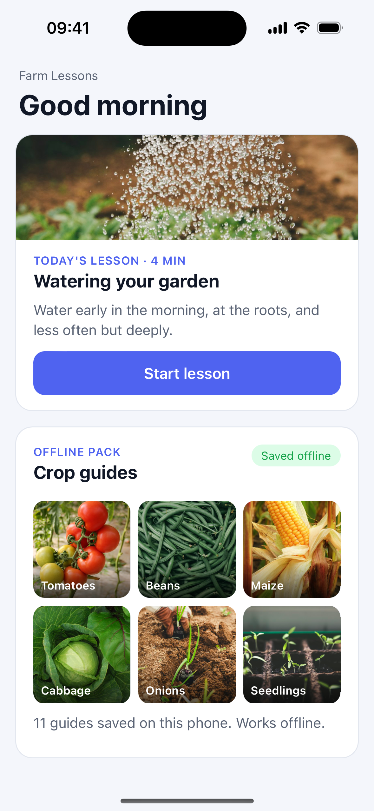
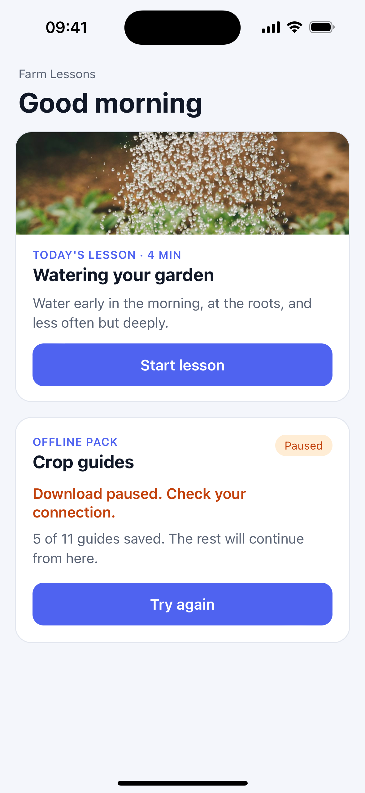

# Capacitor offline download demo

A small Capacitor app that ships only its core screen and downloads extra content **after install, while the app is open**, then keeps it on the phone so it works offline.

It is the demo behind an [AppsCounty](https://appscounty.com/blog) article on keeping mobile apps under the App Store's 200 MB mobile-data download limit.

| Core ready | Downloading | Saved offline | Paused, resumes |
|---|---|---|---|
|  |  |  |  |

## What it shows

- **Core first.** Today's lesson and its photo are bundled with the app, so the first screen works with no download.
- **Extra content on demand.** The 11 crop guides (about 0.6 MB) download only when the user asks, while the app is open. No background downloads, so no extra permissions or notifications.
- **Placeholders and progress**, so the screen is never blank and the user can keep using the app.
- **Resume after failure.** Files already saved are skipped on retry, so a dropped connection does not restart the whole pack.

All of it is plain HTML, CSS and JavaScript in [`www/`](www/); the logic is in [`www/main.js`](www/main.js).

## A Capacitor gotcha: Cache Storage fails on iOS

The first version saved files with the browser's Cache Storage API (`caches.open()` and `cache.put()`). It worked in the browser and failed inside the iOS app with:

```
TypeError: Request url is not HTTP/HTTPS
```

On iOS, Capacitor serves the app from `capacitor://localhost`, and Cache Storage only accepts `http` and `https` requests. The demo stores files in **IndexedDB** instead, which works in both.

For large packs in a real app, prefer the [`@capacitor/filesystem`](https://capacitorjs.com/docs/apis/filesystem) plugin: Capacitor's [storage guide](https://capacitorjs.com/docs/guides/storage) notes that iOS can clear web storage, including IndexedDB, when the device runs low on space.

## Run it

Requirements: Node.js 18+, Xcode (for iOS).

```bash
npm install
npx cap sync ios
npx cap open ios
```

Then run it on a simulator or device from Xcode. To try the web version only, serve the `www` folder with any static server, for example `python3 -m http.server --directory www`.

### Hidden demo controls

There are no visible debug buttons, so screenshots show only the app:

- Tap **the status badge** ("Not downloaded", "Saved offline") to delete the saved guides.
- Tap **"Farm Lessons"** to toggle a slow connection.
- Tap **"Good morning"** to toggle a connection that drops halfway through the download.

## Credits and licence

- Code: [MIT](LICENSE), by Kalemba Jamil, [AppsCounty](https://appscounty.com).
- Photos: from [Unsplash](https://unsplash.com), under the [Unsplash License](https://unsplash.com/license). They are **not** covered by the MIT licence. Sources for each photo are in [`photo-credits.tsv`](photo-credits.tsv).
